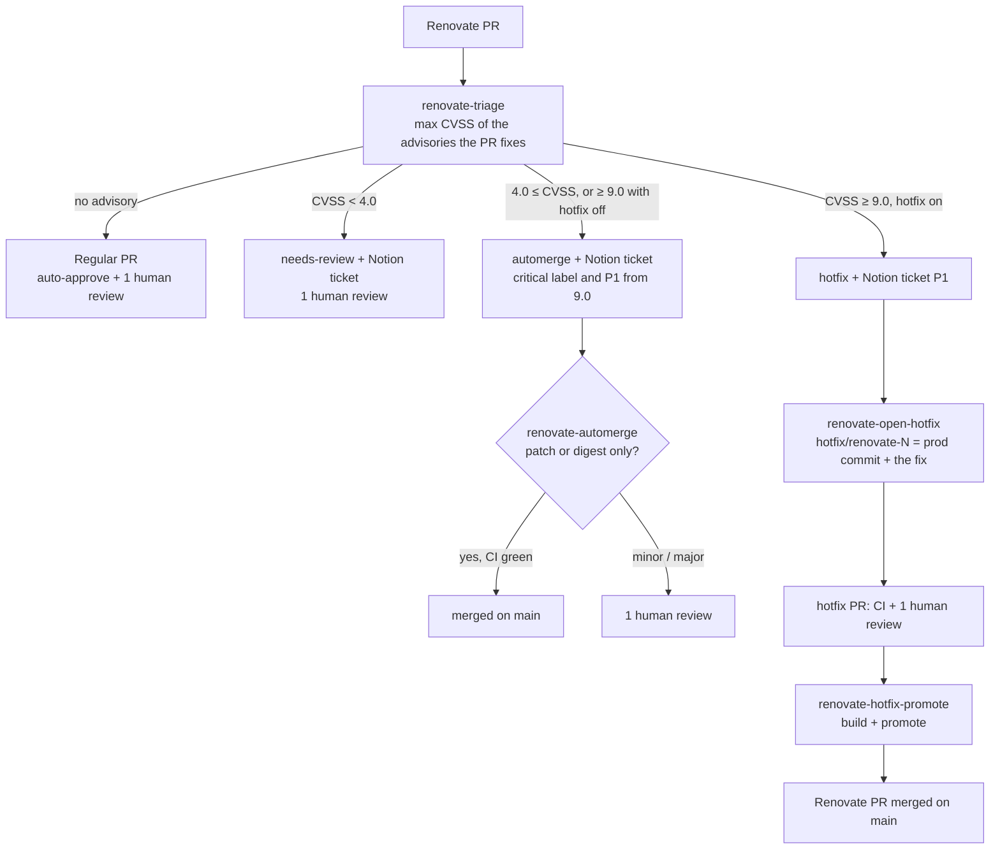

# Renovate security flow

Shared code and guide of the actions that route [Renovate](https://docs.renovatebot.com/) PRs according to the vulnerabilities they fix:

| Action | Role |
|---|---|
| [`renovate-triage`](../renovate-triage/) | Scores the CVEs fixed by a Renovate PR (max CVSS), creates the Notion ticket, labels the PR, comments the advisories and the ticket |
| [`renovate-auto-approve`](../renovate-auto-approve/) | Approves Renovate's own commits, so a Renovate PR needs one human review |
| [`renovate-automerge`](../renovate-automerge/) | Merges green automerge-tier PRs that only bump patch versions or digests |

Ready-to-copy workflows are in [`examples/`](examples/), taken from `algoan/pubsub`.

This public repository holds the subset of the flow used by Algoan's **public** repositories, which can't call the actions of a private repository. The hotfix actions (`renovate-open-hotfix`, `renovate-hotfix-promote`, `prod-image-age`, `prod-fixes-guard`) are not here: run the triage and the automerge with `hotfix_enabled: "false"`.

## Routing



A fix is scored by the advisories that affect the old version and no longer affect the new one. The highest CVSS (v3 or v4) decides the tier. Two cases change that score:

- An advisory without a published CVSS gets one from its severity: critical 9.0, high 7.0, medium 4.0, low 0.1. Only an advisory with neither stays unknown, which means a manual review.
- For an image, a CVE gets the score of the source Trivy takes its severity from, i.e. the distribution for OS packages (Ubuntu's "medium" gives 4.0, even when NVD scores the upstream flaw 9.8).

| Tier | Condition | Labels | What happens |
|---|---|---|---|
| `hotfix` | CVSS ≥ `cvss_hotfix_threshold` (9.0), hotfix on | `security`, `hotfix`, `critical` | Hotfix PR from the production commit; the Renovate PR follows on main once the hotfix is promoted |
| `automerge` | CVSS ≥ `cvss_automerge_threshold` (4.0) | `security`, `automerge` (+ `critical` from 9.0) | Merged once CI is green when every dependency keeps its major.minor (patch) or only its digest changes; otherwise 1 review |
| `manual` | security fix below 4.0, without a known score, or with one fixed advisory that has no score (unless it is a hotfix) | `security`, `needs-review` | 1 human review |
| `none` | no security fix | | Regular Renovate PR |

Closing a hotfix PR without merging it is a decision not to hotfix: later runs leave it closed while Renovate keeps the same versions, and the Renovate PR goes through main. When Renovate moves to other versions, it comments once on its PR to ask for a manual hotfix if needed.

A Notion ticket (*Tickets* database, type *Vulnerability*, P1 to P4 from the CVSS) is created for every security PR. The ticket holds the PR in its *Git Pull Request* field, and the triage comment of the PR links the ticket (`[ALG-1234]`). The id stays out of the PR title: Renovate rewrites its titles, and recognises a PR closed on purpose by its exact title. A hotfix PR, opened by the app, keeps the id in its title.

### Turning the hotfix flow off

The hotfix flow is on by default. A repository that ships everything through its default branch turns it off with either:

- `hotfix_enabled: 'false'` on `renovate-triage` and `renovate-automerge`;
- or a `cvss_hotfix_threshold` above 10 (e.g. the repository variable `CVSS_HOTFIX_THRESHOLD=11`): no CVSS reaches it. Lowering it to 9 or less turns the flow back on.

Critical fixes then take the automerge tier, with the `critical` label, a P1 ticket and a warning to promote them to production quickly. Don't add the `open-hotfix` job nor the hotfix promotion workflow.

## Ecosystems

| Ecosystem | Files | Advisories | Smallest fix | Hotfix replay |
|---|---|---|---|---|
| `uv` | `uv.lock` | GitHub Advisory Database (pip) | yes | `uv lock --no-build --upgrade-package name==version` |
| `poetry` | `poetry.lock` | GitHub Advisory Database (pip) | yes | `poetry add --lock name==version`, direct dependencies only |
| `npm` | `package-lock.json` (v1 to v3) | GitHub Advisory Database (npm) | yes | `npm install --package-lock-only --ignore-scripts --save-exact`, `overrides` for transitive dependencies |
| `pnpm` | `pnpm-lock.yaml` (v5 to v9, one root lockfile or per `lockfile_dir`) | GitHub Advisory Database (npm) | yes | not automated (manual hotfix) |
| `docker` | `FROM` and `COPY --from` images of `Dockerfile*` | Trivy scan of the old and new images | no | the image reference of the Dockerfile |
| `upstream` | `# renovate: … depName=…` pins of `Dockerfile*` (`ENV`/`ARG`) | NVD, matched on the product CPE | no | the pinned value |

They are detected from the files of the repository (`ecosystems: auto`).

- **Smallest fix**: for lockfiles, the hotfix pins the lowest version fixing every advisory, backports included (2.52.2 rather than 2.56.0 when it exists). Renovate's `vulnerabilityFixStrategy: lowest` does the same on the PR.
- **Docker**: images are pinned by digest (`pinDigests`), so a tag republished upstream with security fixes becomes a `digest` update, merged automatically when it fixes a CVE of 4.0 or more. A private image needs the registry login before the action.
- **Upstream sources** (e.g. openssl, nginx or luajit built from source in `algoan/gateway-proxy`): no package database knows them, so they are matched in NVD by their CPE product. Give it with a `cpe=vendor:product` field on the comment, or the `upstream_cpes` input:

  ```dockerfile
  # renovate: datasource=github-tags depName=openssl/openssl extractVersion=^openssl-(?<version>.+)$ cpe=openssl:openssl
  ENV OPENSSL_VERSION=3.6.5
  ```

  Dependencies without a CPE (most Lua modules) are listed as *not scored*: they don't change the tier. A hotfix replays every pin the PR changes, so modules Renovate updates together (a `groupName`) stay paired. Set an `NVD_API_KEY` secret to raise the NVD rate limit (5 to 50 requests per 30 seconds).

## Adopting the flow

1. Install the [Mend Renovate](https://github.com/apps/renovate) app on the repository (or [self-host Renovate](#self-hosted-renovate)) and enable Dependabot alerts.
2. Add the Renovate configuration below to `renovate.json`.
3. In the default branch ruleset, add the CI jobs as required status checks, and allow the merge method `renovate-automerge` uses (`squash` by default, `merge_method` otherwise).
4. Choose how `renovate-automerge` merges:
   - **without any secret** (public repositories): leave `app_id` empty and give the workflow `contents: write` and `pull-requests: write`. The `GITHUB_TOKEN` merges like anyone would, so the ruleset must require no approval. A merge by the `GITHUB_TOKEN` starts no workflow on the default branch;
   - **with a bypass GitHub App**, where the ruleset requires approvals: install the app on the repository, add it as a bypass actor in *pull requests only* mode, and pass `app_id` and `private_key`. Require **2 approvals** and **Dismiss stale pull request approvals when new commits are pushed**, and add `renovate-auto-approve` (with **Allow GitHub Actions to create and approve pull requests**), so a human always gives one approval. Never pass the key of an app installed on private repositories to a public repository.
5. Copy the workflows of [`examples/`](examples/) into `.github/workflows/`. Adapt the inputs and the CI workflow names in `renovate-automerge.yml`, and pin `algoan/renovate-security-actions` to a release commit SHA, with its tag in a comment (Renovate's `github-actions` manager keeps both up to date).

Repository variables read by the examples: `CVSS_HOTFIX_THRESHOLD` (9.0), `CVSS_AUTOMERGE_THRESHOLD` (4.0), `AUTOMERGE_REQUIRED_CHECKS`.

### Renovate configuration

```json
{
  "$schema": "https://docs.renovatebot.com/renovate-schema.json",
  "extends": ["config:recommended", ":semanticCommits"],
  "labels": ["dependencies"],
  "osvVulnerabilityAlerts": true,
  "vulnerabilityAlerts": {
    "description": "Security fixes are opened immediately, pinned to the lowest fixing version, and routed by renovate-triage.",
    "labels": ["dependencies", "security"],
    "schedule": ["at any time"],
    "prCreation": "immediate",
    "rangeStrategy": "pin",
    "vulnerabilityFixStrategy": "lowest",
    "minimumReleaseAge": null,
    "automerge": false
  },
  "packageRules": [
    {
      "description": "Images are pinned by digest: an upstream security rebuild becomes a digest update.",
      "matchManagers": ["dockerfile"],
      "pinDigests": true
    }
  ]
}
```

Keep Renovate's own `automerge` off: merges go through `renovate-automerge`, which re-checks the tier, the files and the commit signatures.

With `rangeStrategy: pin`, a dependency declared with a range (`>=4.38`) first gets a *pin* PR to its locked version. The triage comments it as **Pin only**; once merged, Renovate opens the actual fix.

### Self-hosted Renovate

The flow trusts the Mend app (`renovate[bot]`) by default. When Renovate runs in GitHub Actions as
its own GitHub App instead (for instance when the Mend runner lacks memory, or to read GitHub Packages
with the workflow `GITHUB_TOKEN` rather than a PAT):

- enable `platformCommit` in `renovate.json`, so its commits are signed by GitHub;
- filter the triage and auto-approve workflows on `<slug>[bot]` instead of `renovate[bot]`;
- pass the app to `renovate-auto-approve` (`renovate_app_slug`) and `renovate-automerge`
  (`renovate_app_slug` and `renovate_email`, the noreply email of its bot user:
  `gh api 'users/<slug>[bot]' --jq '"\(.id)+\(.login)@users.noreply.github.com"'`).

## Security model

- The triage runs on `pull_request_target` from the base commit: the PR head is only read as git objects. The actions are pinned by commit SHA.
- `renovate-automerge` only merges a PR whose commits are all authored by Renovate (`renovate_app_slug` / `renovate_email`) and signed by GitHub, touching dependency files only. Other files need `allowed_paths` or a `<!-- renovate:` marker. The merge is pinned to the checked head commit. Since a bypass app skips the review rules, the action checks the reviews itself, before the scans and again right before merging: a change request from a writer or an unresolved review thread stops the merge (only a review submitted in the second between that last check and the merge would be missed). Resolving a thread starts no workflow: once the objection is cleared, run the automerge with the PR number, or let the next CI run start it.
- Hotfix replays run the package managers without any token-like variable, without install scripts nor build backends (`uv --no-build`, `npm --ignore-scripts`). Callers check out with `persist-credentials: false`.

## Development

```bash
cd renovate-security
pip install pytest pyyaml
python -m pytest
# Score a diff locally
GITHUB_TOKEN=$(gh auth token) PYTHONPATH=. python -m renovate_security triage --base origin/main --head HEAD --out /tmp/t.json --markdown /tmp/t.md
python -m renovate_security.notion_ticket upsert --dry-run --pr-url <pr-url> --triage /tmp/t.json
```
